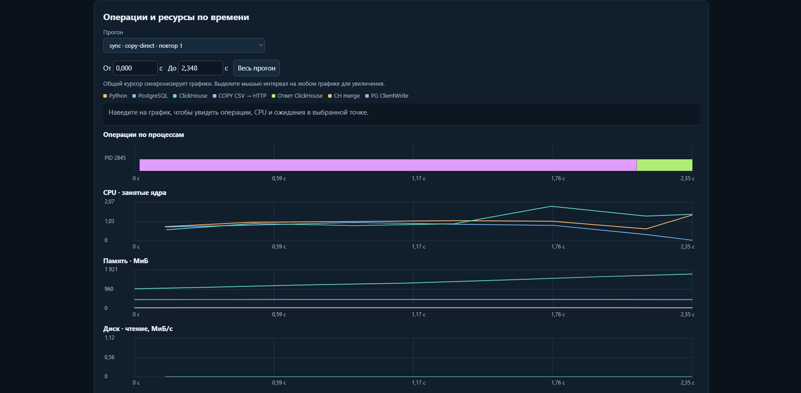
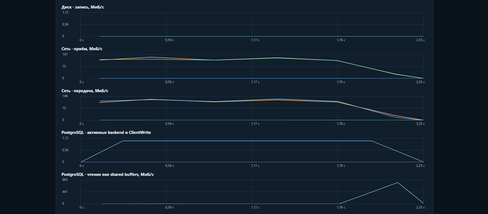
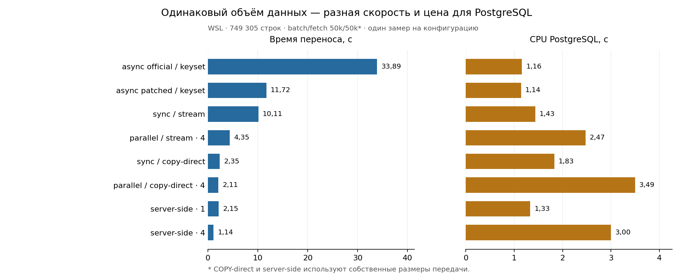

# PostgreSQL → ClickHouse ETL benchmark

Стенд сравнивает способы переноса данных по скорости и нагрузке на Python,
PostgreSQL и ClickHouse. Интерактивный отчёт связывает чтение, подготовку данных
и вставку с CPU, памятью, диском и сетью каждого компонента.

Он помогает выбрать число воркеров, размер пачки и способ чтения под доступные
ресурсы. Например, ускорение загрузки можно сопоставить с дополнительными
CPU-секундами на стороне PostgreSQL, который обслуживает рабочее приложение.





## Результаты

Источник — 749 305 строк текстового med_technic, 243,7 МБ CSV.
Поля CSV загружены в PostgreSQL как text, в ClickHouse — как Nullable(String).
Служебный ключ etl_row_num имеет первичный индекс. Цель — MergeTree
с сортировкой по этому ключу.

Измерения выполнены на локальных базах в Ubuntu WSL с 8 CPU и 9,7 ГиБ RAM,
PostgreSQL 14.24 и ClickHouse 26.8.2.7. Прогоны шли последовательно
после прогрева. В полной таблице по одному замеру каждой конфигурации.
Эти значения относятся к WSL; Docker-пакет позволяет повторить сравнение
на своём оборудовании.

Batch/fetch равны 50k/50k. В copy-direct и server-side эти параметры
не управляют размером передачи. CPU-секунды показывают суммарную работу ядер
за перенос. Два ядра, занятые одну секунду, дают две CPU-секунды.

| Режим | Reader | Воркеры | Время, с | Тыс. строк/с | CPU Python, с | CPU PostgreSQL, с | CPU ClickHouse, с | Пик RAM Python / PG / CH, МиБ |
|---|---|---:|---:|---:|---:|---:|---:|---:|
| server-side | — | 4 | 1,14 | 657,1 | 0,14 | 3,00 | 4,03 | 52 / 459 / 1 824 |
| parallel | copy-direct | 4 | 2,11 | 354,9 | 4,74 | 3,49 | 4,39 | 256 / 463 / 1 803 |
| server-side | — | 1 | 2,15 | 349,0 | 0,22 | 1,33 | 2,27 | 48 / 456 / 1 874 |
| sync | copy-direct | 1 | 2,35 | 319,1 | 2,21 | 1,83 | 2,56 | 54 / 455 / 1 713 |
| parallel | stream | 4 | 4,35 | 172,4 | 15,11 | 2,47 | 3,08 | 1 013 / 474 / 1 105 |
| parallel | keyset | 4 | 4,58 | 163,7 | 15,52 | 2,82 | 3,28 | 1 185 / 459 / 1 107 |
| parallel | copy | 4 | 5,39 | 139,0 | 20,18 | 2,51 | 3,31 | 893 / 474 / 1 094 |
| parallel | cursor | 4 | 9,69 | 77,3 | 32,16 | 5,35 | 9,25 | 1 097 / 444 / 1 318 |
| sync | cursor | 1 | 9,91 | 75,6 | 8,82 | 1,70 | 3,31 | 273 / 465 / 1 742 |
| sync | stream | 1 | 10,11 | 74,1 | 9,35 | 1,43 | 2,68 | 291 / 457 / 999 |
| sync | keyset | 1 | 11,29 | 66,4 | 10,09 | 2,24 | 3,60 | 272 / 452 / 961 |
| async patched | keyset | 1 | 11,72 | 64,0 | 12,05 | 1,14 | 3,35 | 337 / 457 / 999 |
| hybrid | keyset | 1 | 12,02 | 62,3 | 12,45 | 1,11 | 3,22 | 289 / 457 / 1 509 |
| hybrid | cursor | 1 | 12,11 | 61,9 | 12,55 | 1,38 | 3,18 | 320 / 461 / 1 616 |
| sync | copy | 1 | 12,42 | 60,3 | 12,18 | 1,35 | 3,42 | 213 / 456 / 941 |
| async patched | cursor | 1 | 12,87 | 58,2 | 13,25 | 1,44 | 3,20 | 345 / 461 / 949 |
| hybrid | stream | 1 | 13,40 | 55,9 | 13,81 | 1,05 | 3,70 | 334 / 455 / 1 005 |
| async patched | stream | 1 | 16,64 | 45,0 | 17,25 | 1,42 | 4,62 | 334 / 454 / 956 |
| async official | keyset | 1 | 33,89 | 22,1 | 34,80 | 1,16 | 5,48 | 330 / 457 / 1 423 |
| async official | cursor | 1 | 34,33 | 21,8 | 35,28 | 1,41 | 5,80 | 339 / 460 / 952 |
| async official | stream | 1 | 35,04 | 21,4 | 35,97 | 1,09 | 5,42 | 326 / 456 / 964 |

RAM в последнем столбце указана отдельно для Python, PostgreSQL и ClickHouse.
Это пик working set всего компонента, включая служебную память и часть кешей.
Пики могут приходиться на разные моменты. 


## Что эти результаты позволяют решить



На рисунке восемь конфигураций из полной таблицы. Слева — длительность переноса,
справа — вычислительная работа источника. Укорочение окна ETL может сопровождаться
ростом суммарной нагрузки на PostgreSQL.

**Ускорить полную перегрузку или беречь источник.** Четыре server-side воркера
сократили время с 2,15 до 1,14 с — ускорение в 1,88 раза. За это PostgreSQL
потратил в 2,25 раза больше CPU, ClickHouse — в 1,78 раза.
Если важнее короткое окно загрузки, четыре воркера заслуживают проверки.
Если загрузка делит PostgreSQL с рабочим приложением, одиночный вариант
требует меньше CPU на тот же объём. Для решения о запуске в рабочее время
нужно дополнительно измерить задержки запросов приложения.

**Понять, окупаются ли дополнительные процессы.** У copy-direct четыре процесса
сэкономили 0,24 с относительно одного: 2,11 против 2,35 с.
Суммарный CPU трёх компонентов вырос с 6,60 до 12,63 с,
а пиковая память Python — с 54 до 256 МиБ.
Такой результат позволяет сопоставить небольшой выигрыш по времени
с доступным бюджетом CPU и памяти.

**Ускорить клиентский код без дополнительных воркеров.** При keyset замена
официального writer asynch на Cython сократила перенос с 33,89 до 11,72 с.
CPU Python снизился с 34,80 до 12,05 с, CPU PostgreSQL остался около 1,15 с.
Это пример, когда оптимизация сериализации клиента даёт ускорение
без сопоставимого роста затрат источника. Для cursor ускорение составило
2,67 раза, для stream — 2,11 раза.

**Проверить цену параллелизма при обработке строк.** Parallel stream перенёс
набор за 4,35 с вместо 10,11 с у sync stream.
Память Python выросла с 291 до 1013 МиБ, его CPU — с 9,35 до 15,11 с.
Для загрузчика с ограничением памяти такая таблица показывает,
помещается ли ускоренный вариант в лимит.

## Что подтвердили повторные замеры

[Отдельная серия server-side](docs/server-side-repeats.csv) содержит по шесть повторов с чередованием
одного, двух и четырёх воркеров. Это дополнительные измерения того же набора.

| Воркеры | Медиана времени, с | Минимум–максимум, с | Медиана CPU PostgreSQL, с | Медиана CPU ClickHouse, с |
|---:|---:|---:|---:|---:|
| 1 | 2,45 | 2,22–2,75 | 1,45 | 2,62 |
| 2 | 1,71 | 1,56–2,05 | 2,25 | 3,47 |
| 4 | 1,15 | 1,12–1,22 | 3,06 | 3,67 |

Четыре воркера выигрывали во всех шести раундах. Ускорение по медиане — 2,12 раза.
Через auto_explain записаны планы фактических COPY из ClickHouse:
одиночный запрос использовал Seq Scan, каждый диапазон при двух
и четырёх воркерах — Index Scan. Планы оставались одинаковыми при каждом
числе воркеров.

Эта серия подтверждает выигрыш параллельного server-side для данного источника
и окружения. Для остальных конфигураций в полной таблице пока по одному
замеру. Для другого набора данных, удалённых баз или конкурирующей нагрузки
нужна своя серия.

## Стек и режимы

Python 3.10, psycopg 3.2.3, clickhouse-driver 0.2.10, asynch 0.3.1,
Cython 3, PostgreSQL 14, ClickHouse 26.8, Docker Compose.

- Sync последовательно читает и вставляет.
- Async использует две корутины и очередь на две пачки.
- Async patched заменяет writer на Cython-реализацию.
- Hybrid читает асинхронно и пишет синхронным драйвером в отдельном потоке.
- Parallel делит диапазон ключей между четырьмя процессами.
- Server-side поручает перенос ClickHouse. Вариант с четырьмя воркерами запускает четыре серверных запроса через потоки Python.

Доступны stream, серверный cursor и keyset. Для sync и parallel также есть
бинарный COPY и CSV COPY → HTTP INSERT. У copy-direct и server-side
batch/fetch не управляют размером передачи.

## Запуск

Нужны Docker с Linux-контейнерами, Compose и Python 3.10+ на хосте.
Python на хосте запускает Docker CLI; сторонние Python-пакеты на хосте не нужны.

```bash
docker compose build bench
python run_med_matrix.py
docker compose --profile dashboard up -d dashboard
```


Для замера своего набора положите UTF-8 CSV с заголовком в `data/`.
Первый запуск загружает его в PostgreSQL:

```bash
python run_med_matrix.py --csv source.csv --series source-run --repeats 3
```

Для смены набора после первой загрузки используйте отдельный Compose-проект
через переменную окружения `COMPOSE_PROJECT_NAME`. Он получит свои volumes.
Повторный prepare переиспользует существующую таблицу. Повторный запуск серии
пропускает сохранённые профили; новое имя серии запускает новые измерения.

Отдельные режимы после подготовки источника:

```bash
docker compose run --rm bench async --driver patched --reader keyset
docker compose run --rm bench parallel --workers 4 --reader copy
docker compose run --rm bench server-side --workers 4
```

Проверка кода с обеими базами:

```bash
docker compose run --rm --entrypoint python -e RUN_DB_TESTS=1 bench -m unittest -v tests.test_benchmark
```

`docker compose down` останавливает службы, сохраняя базы.
`docker compose down -v` удаляет базы и метаданные, после чего нужна новая загрузка.


